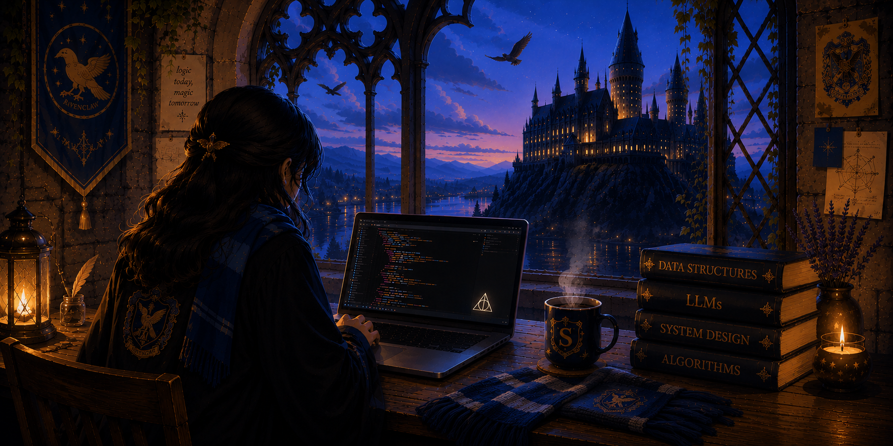

  

  <code>Brewing ideas. Building systems.</code>

  &nbsp;&nbsp;&nbsp;&nbsp;&nbsp;&nbsp;

  

### `~$ whoami`

Someone who likes understanding how things work under the hood, and occasionally overengineering them just for the fun of it.

### `~$ currently`

- building with **backend, AI agents & real-time systems**
- learning **LLMs, Agentic AI & system design**
- solving **DSA & algorithmic problems**

### `~$ next`

- deeper into **system design**
- exploring **LLMs**
- building things **worth keeping**

  <code>Ministry of Questionable Engineering</code>
    
  <i>I write code. The wand is for emergencies.</i>

